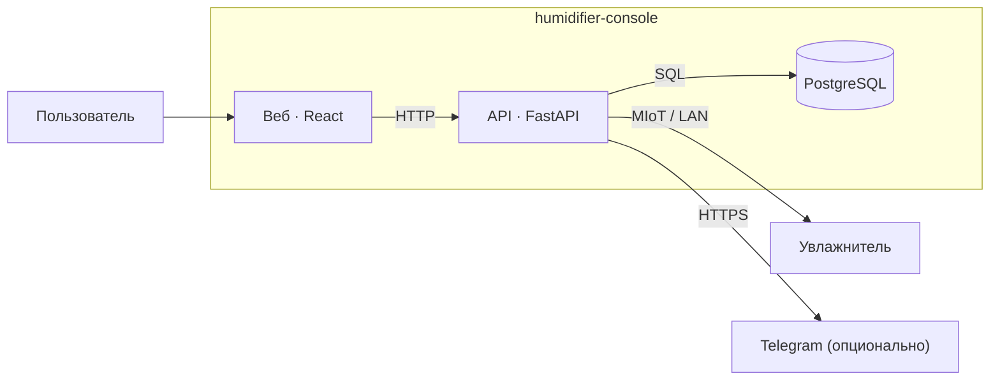
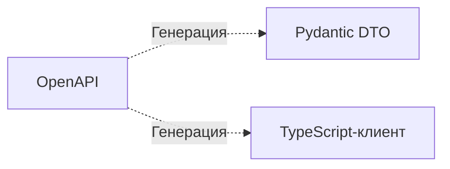

# humidifier-console

Локальная веб-консоль для Smartmi Evaporative Humidifier 3 Lite (`zhimi.humidifier.ca7`): управление, показания, история, сценарии, расписания и автоматизации.

Приложение общается с прибором по LAN через MIoT.
Для запуска нужен реальный увлажнитель с известными IP и токеном.
Автоматические тесты используют изолированную подмену устройства.

## Возможности и ограничения

- Отображение показаний (влажность / температура).
- Выполнение команд с проверкой результата.
- Хранение истории, событий, сценариев, расписаний и автоматизация влажности.
- Уведомления в Telegram.


Панель рассчитана на доверенную домашнюю сеть и не имеет аутентификации.
Не публикуйте её в интернете. Условия эксплуатации и работа с секретами:
[безопасность](SECURITY.md).

## Архитектура

Уровень C4 Container, Mermaid.



OpenAPI служит источником моделей и клиента для обеих сторон.
Генерация выполняется при разработке командой `corepack pnpm codegen`
и показана отдельно от взаимодействий работающего приложения:



## Запуск

Нужен Docker Desktop с Linux-контейнерами либо Docker Engine с Compose v2.

1. Для первой установки скопируйте `.env.example` в `.env` и задайте `POSTGRES_PASSWORD`.
2. Сохраните IP и токен прибора в `device.local.json` по образцу `device.example.json`. Обновление токена: [TOKEN.md](TOKEN.md).
3. Запустите:

```sh
docker compose up -d --build
```

Панель: **http://localhost:8080**.
Файлы `.env` и `device.local.json` содержат локальные секреты и исключены из Git.

Серверу нужен доступ к прибору по UDP 54321. API и PostgreSQL доступны только внутри Compose.
Не запускайте одновременно несколько API для одного прибора и БД.
Интерфейс и управление работают по LAN; Telegram требует интернета и настраивается через переменные в `.env`.

## Обновление и остановка

```sh
docker compose up -d --build
docker compose stop
```

После изменения IP/токена пересоздайте API по [инструкции](TOKEN.md). Простого изменения файла недостаточно: подключение хранится в памяти процесса.

История и настройки находятся в постоянном томе PostgreSQL. `docker compose down` сохраняет тома; `docker compose down -v` удаляет базу.

## Разработка

Python 3.12, Node.js 24, pnpm 11. Локальные зависимости и кэши восстанавливаются командой:

```sh
corepack pnpm bootstrap
```

Основные команды: `corepack pnpm dev`, `corepack pnpm codegen`, `corepack pnpm check`, `corepack pnpm test:e2e`. Для E2E сначала выполните `corepack pnpm --dir web exec playwright install chromium`.

Для разработки на хосте `corepack pnpm db:up` публикует PostgreSQL на `127.0.0.1:5432`. Если порт занят, измените его в `compose.dev.yaml` и задайте соответствующий `PGPORT`. Перед запуском API примените Alembic с настроенными `PGHOST`, `PGPORT`, `PGUSER`, `PGPASSWORD`, `PGDATABASE` или `DATABASE_URL`.

На Windows Python проекта: `.venv/Scripts/python.exe`; на Linux: `.venv/bin/python`. Диагностика только чтением: `python diagnose.py check` этим интерпретатором. `TEST_DATABASE_URL` включает тесты на PostgreSQL; иначе тесты используют SQLite.

Исходники: `api/`, `web/`, `contracts/`. Контракт собирается из YAML; `contracts/dist` и сгенерированные Python/TypeScript-модели входят в проект и не редактируются вручную. CI проверяет генерацию, миграции, тесты и сборку.


## Участие в разработке

Python-зависимости управляются через uv и `uv.lock`; установите uv перед
`corepack pnpm bootstrap`. JavaScript-зависимости закреплены в `pnpm-lock.yaml`.
Изменения контракта сопровождаются перегенерацией клиента и моделей.

CI проверяет статический анализ, тесты, миграции PostgreSQL, воспроизводимость
генерации и сборку. Результаты автоматических тестов не заменяют проверку
физического прибора. [Разработка с AI](docs/guides/ai-development.md) описывает
порядок работы и пример регрессионного исправления.


## Правила разработки

[Карта документации](docs/README.md), [фронт](docs/rules/web-guidelines.md),
[проверки и Git-хуки](docs/guides/checks.md).
