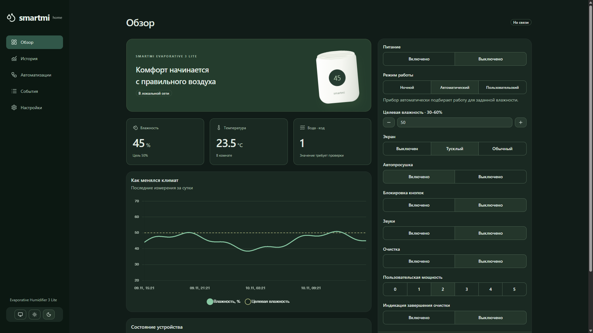
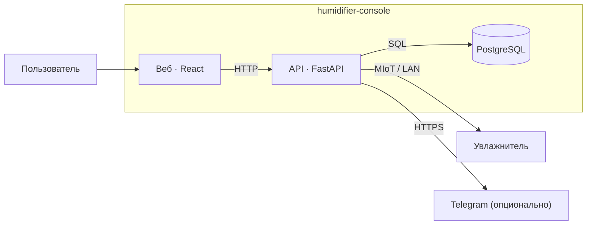
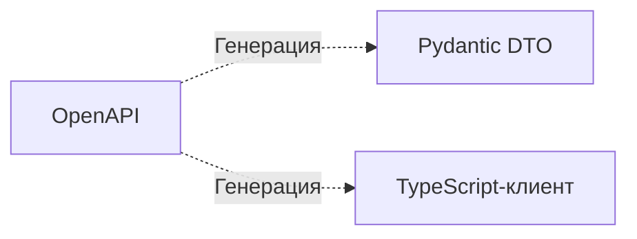

# humidifier-console

Локальная веб-консоль для Smartmi Evaporative Humidifier 3 Lite (`zhimi.humidifier.ca7`): управление, показания, история, сценарии, расписания и автоматизации.

Приложение общается с прибором по LAN через MIoT.
Для запуска нужен реальный увлажнитель с известными IP и токеном.
Автоматические тесты используют изолированную подмену устройства.

## Возможности и ограничения

- Отображение показаний (влажность / температура).
- Выполнение команд с проверкой результата.
- Хранение истории, событий, сценариев, расписаний и автоматизация влажности.
- Уведомления в Telegram.



Панель рассчитана на доверенную домашнюю сеть и не имеет аутентификации.
Не публикуйте её в интернете. Условия эксплуатации и работа с секретами:
[безопасность](SECURITY.md).

## Архитектура

Уровень C4 Container, Mermaid.



OpenAPI служит источником моделей и клиента для обеих сторон.
Генерация выполняется при разработке командой `corepack pnpm codegen`
и показана отдельно от взаимодействий работающего приложения:



## Запуск

Нужен Docker Desktop с Linux-контейнерами либо Docker Engine с Compose v2.

1. Для первой установки скопируйте `.env.example` в `.env` и задайте `POSTGRES_PASSWORD`.
2. Сохраните IP и токен прибора в `device.local.json` по образцу `device.example.json`. Обновление токена: [TOKEN.md](TOKEN.md).
3. Запустите:

```sh
docker compose up -d --build
```

Панель: **http://localhost:8080**.
Файлы `.env` и `device.local.json` содержат локальные секреты и исключены из Git.

Серверу нужен доступ к прибору по UDP 54321. API и PostgreSQL доступны только внутри Compose.
Не запускайте одновременно несколько API для одного прибора и БД.
Интерфейс и управление работают по LAN; Telegram требует интернета и настраивается через переменные в `.env`.

## Обновление и остановка

```sh
docker compose up -d --build
docker compose stop
```

После изменения IP/токена пересоздайте API по [инструкции](TOKEN.md). Простого изменения файла недостаточно: подключение хранится в памяти процесса.

История и настройки находятся в постоянном томе PostgreSQL. `docker compose down` сохраняет тома; `docker compose down -v` удаляет базу.

## Разработка

Нужны Python 3.12, uv, Node.js 24 и pnpm 11.

```sh
corepack pnpm bootstrap  # установить зависимости
corepack pnpm db:up      # запустить PostgreSQL
corepack pnpm dev        # запустить приложение
corepack pnpm check      # выполнить проверки
```

Перед первым запуском API настройте БД через `DATABASE_URL` или переменные `PG*`
и примените миграции Alembic. PostgreSQL доступен на `127.0.0.1:5432`;
порт меняется в `compose.dev.yaml` и `PGPORT`.

Для E2E установите браузер: `corepack pnpm --dir web exec playwright install chromium`,
затем выполните `corepack pnpm test:e2e`. Для тестов на PostgreSQL задайте
`TEST_DATABASE_URL`; по умолчанию используется SQLite.

Исходники: `api/`, `web/`, `contracts/`. После изменения YAML-контракта выполните
`corepack pnpm codegen`; сгенерированные файлы вручную не меняйте.
Автоматические проверки не заменяют тестирование реального прибора.

## Правила разработки

[Карта документации](docs/README.md), [фронт](docs/rules/web-guidelines.md),
[проверки и Git-хуки](docs/guides/checks.md), [разработка с AI](docs/guides/ai-development.md).
